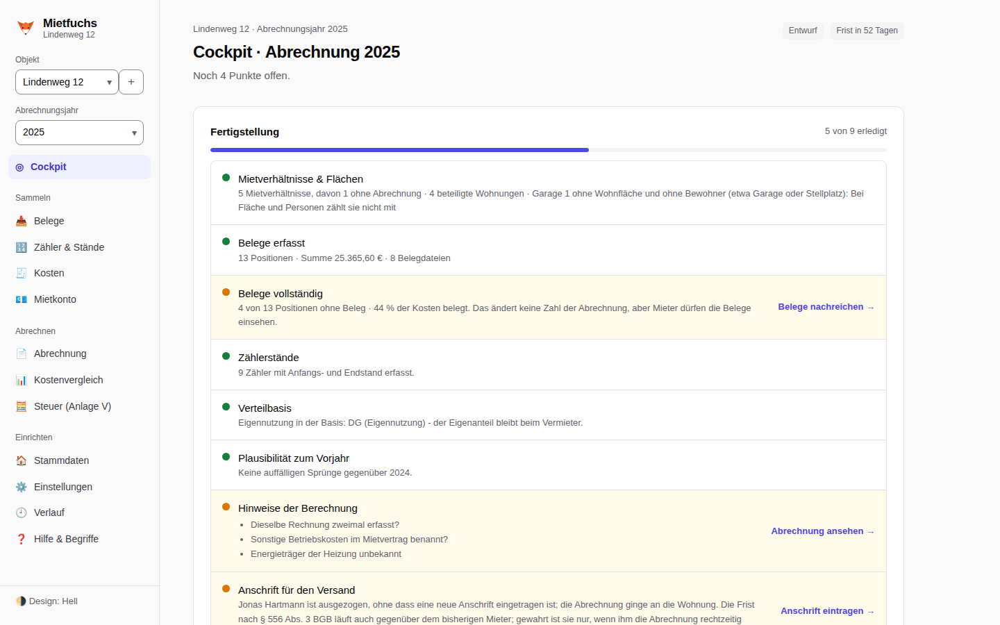
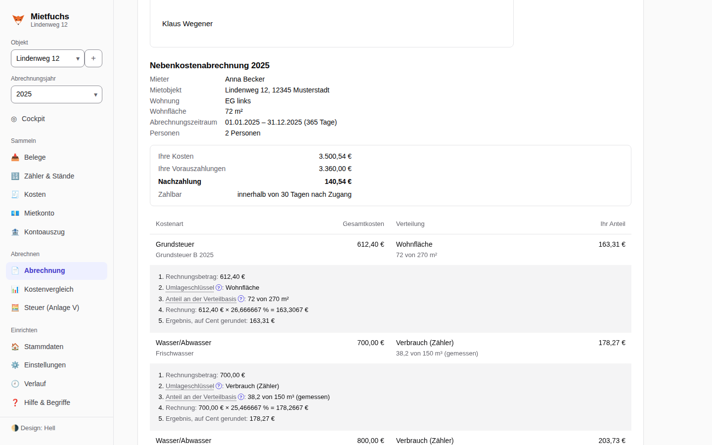
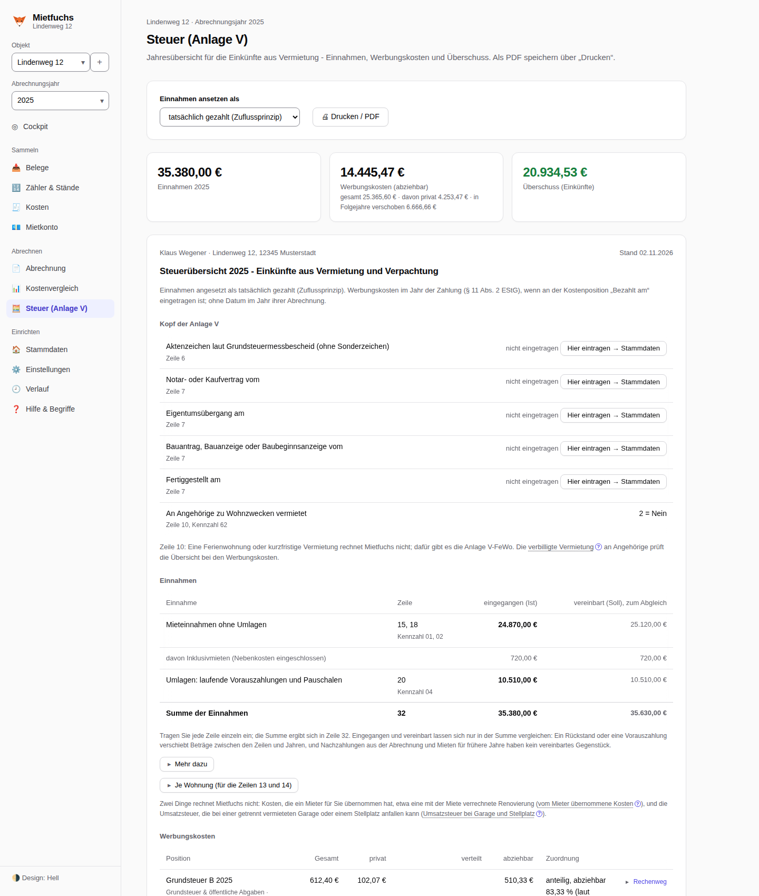

<p align="center">
  
</p>

<h1 align="center">Mietfuchs</h1>

<p align="center">
  <b>Die kostenlose Nebenkostenabrechnung für private Vermieter, komplett auf dem eigenen Rechner.<br>
  Keine Cloud, kein Konto, keine Abogebühren.</b>
</p>

<p align="center">
  <a href="https://mietfuchs-app.de">Website</a> ·
  <a href="https://mietfuchs-app.de/herunterladen">Herunterladen</a> ·
  <a href="https://apps.microsoft.com/detail/9PMHZ0ZJPZDZ">Microsoft Store</a> ·
  <a href="docs/">Dokumentation</a>
</p>

<p align="center">
  <a href="LICENSE"></a>
  <a href="https://github.com/speedone/mietfuchs/releases/latest"></a>
  
  
  
</p>

Mietfuchs nimmt dir die jährliche **Nebenkostenabrechnung** (Betriebskostenabrechnung) ab: Kosten
und Belege erfassen (optional per lokaler KI-Auswertung), Zählerstände pflegen, die
**Heizkostenabrechnung** nach der Heizkostenverordnung erstellen oder die eines Messdienstes
übernehmen, und am Jahresende eine fertige, centgenau verteilte Abrechnung je Mieter ausdrucken,
inklusive Mietkonto und Steuer-Übersicht für die **Anlage V**. Gemacht für **private Vermieter**:
ob ein Mehrfamilienhaus, mehrere Häuser, eine vermietete Eigentumswohnung oder das eigene Haus mit
Einliegerwohnung. Alle Daten liegen **lokal** in einer Datenbank bei dir, **ohne Cloud und ohne
Konto**.

Mehr auf der Website **[mietfuchs-app.de](https://mietfuchs-app.de)**: Funktionen, Download für jedes
System und Ratgeber zur Nebenkostenabrechnung (Frist, Vorlage, umlagefähige Kosten, Heizkosten, Steuer).

<p align="center">
  <a href="https://apps.microsoft.com/detail/9PMHZ0ZJPZDZ?referrer=appbadge&mode=direct"></a>
</p>



| Abrechnung je Mieter, mit Rechenweg | Steuer-Übersicht (Anlage V) mit Eigennutzung |
| --- | --- |
| [](docs/screenshots/abrechnung.png) | [](docs/screenshots/steuer.png) |

<sub>Alle Abbildungen zeigen frei erfundene Beispieldaten. Weitere Ansichten (Mietkonto, Belege, Kosten, Zähler …)
unter [Funktionsweise](docs/funktionsweise.md#ansichten).</sub>

## Funktionen

**Objekte und Mietverhältnisse**

- 🏘️ **Mehrere Objekte** in einer Installation: Häuser und Eigentumswohnungen, jedes rechnet für sich
- 🏠 **Selbstgenutzte Wohnung, Garage, Stellplatz:** zählen in die Verteilbasis, der Anteil der selbstgenutzten bleibt beim Vermieter
- 🛏️ **Zimmer einer Wohnung (WG)** einzeln vermieten: jedes Zimmer mit Anteil an der Wohnfläche, die Wohnung zählt genau einmal
- 📈 **Staffeln** für Personenzahl, Vorauszahlung, Kaltmiete und Pauschale: kein neues Mietverhältnis bei Geburt, Auszug oder Erhöhung
- 🧾 **Nebenkostenmodell je Mietverhältnis:** Abrechnung, Pauschale oder Inklusivmiete, getrennt für kalte Betriebskosten und Heizung
- 📅 **Abrechnungszeitraum wählbar:** Kalenderjahr oder etwa Mai bis April, mit Vorschau beim Wechsel
- 📡 **Baujahr der Kabel- oder Antennenanlage** am Objekt, denn davon hängt ab, ob ihre Kosten nach 2024 noch umlagefähig sind
- 🗃️ **Erweiterte Stammdaten** (Kontakt, Kaution, Vertragsdatum, Zimmer/Etage) optional je Mieter und Wohnung

**Kosten und Verteilung**

- 🧮 **Centgenaue Verteilung** nach Wohnfläche, Personenzahl, Wohneinheiten, Verbrauch, direkt, vereinbarten Anteilen, laut Hausgeldabrechnung oder mit Einzelbeträgen
- ✂️ **Eine Rechnung, mehrere Positionen** mit eigenem Umlageschlüssel; die Verteilbasis lässt sich je Position eingrenzen (z. B. Aufzug nur für die oberen Etagen)
- 🔁 **Kosten aus dem Vorjahr übernehmen:** Positionen samt Umlageschlüssel übernehmen, nur den neuen Betrag eintragen; den Schlüssel merkt sich Mietfuchs je Kostenart
- 🛠️ **§35a-Lohnanteil, Gutschriften, Erhaltungsrücklage** und Reparaturen, die sich für die Steuer einer Einheit zuordnen lassen
- 📆 **Leerstand und Zeiträume:** Leerstand trägt der Vermieter, eine Rechnung über zwei Zeiträume teilt Mietfuchs nach Tagen auf
- 📏 **Zähler** mit Jahres- und Zwischenablesung beim Mieterwechsel, Zählerwechsel, geschätzter Ablesung mit Begründung, Plausibilitäts- und Eichfrist-Warnung
- 💧 **Allgemeinverbrauch am Hauptzähler** (Treppenhaus, Garten, Messdifferenz) nach Zählern, Fläche, Personen oder Einheiten verteilen, auch über Zähler für einen Teil des Hauses wie den Allgemeinstrom

**Heizung und Warmwasser**

- 🔥 **Eigene Heizkostenabrechnung** nach §§ 7 bis 9 HeizkostenV mit Wärme- und Warmwasserzählern oder Heizkostenverteilern
- 📋 **Abrechnung eines Messdienstes übernehmen,** auf Wunsch per KI ausgelesen
- 🌍 **CO₂-Kosten** nach dem Stufenmodell des CO2KostAufG zwischen Mieter und Vermieter aufteilen
- 🛢️ **Brennstoffvorrat, mehrere Heizanlagen, Etagenheizungen, Kesseltausch** und eine eigene Heizperiode; Betriebsstrom aus dem Allgemeinstrom herausrechnen
- ⚖️ **Kürzungsrecht im Blick:** Hinweis nach § 12 HeizkostenV bei Verteilung ohne Verbrauchsanteil und bei Geräten, die aus der Ferne ablesbar sein müssen

**Abrechnung, Mietkonto, Steuer**

- 📄 **Fertige Abrechnung** je Mieter mit Saldo, Zahlungsaufforderung, §35a-Bescheinigung und Vorschlag zur Vorauszahlungsanpassung (§560 BGB); Druck oder PDF
- 🔍 **Rechenweg** jeder Zeile aufklappbar; eine Abrechnung wird vor dem Versand abgeschlossen und eingefroren, der Versand danach mit Datum festgehalten, spätere Abweichungen zeigt Mietfuchs je Mieter
- ⏰ **Fristen im Blick:** Erinnerung an die 12-Monats-Abrechnungsfrist (§556 BGB)
- 💶 **Mietkonto:** Soll/Ist je Monat, fällige Rückstände auf einen Blick, Ein- und Auszug im Lauf eines Monats nach Kalendertagen
- 🧾 **Steuer-Übersicht (Anlage V):** Einnahmen nach Zufluss, Werbungskosten und Überschuss aufs Jahr; wohnst du selbst im Haus, ist jede Position in abziehbar und privat aufgeteilt

**Belege**

- 📥 **Eingang:** den ganzen Stapel ablegen, Rechnungen und Zählerfotos gemischt, prüfen und übernehmen
- 🗂️ **Ordner** je Objekt, Jahr und Kostenart, mit Suche über alle Jahre und Belegabdeckung („85 % der Kosten belegt“); denselben Beleg erkennt Mietfuchs am Inhalt
- 📦 **Belegmappe für Mieter** als PDF (Belegeinsicht nach § 556 Abs. 4 BGB) und alle Belege für die Steuer als ZIP
- 🧷 **Eine Rechnung landet genau einmal in den Kosten:** jede Zeile neu anlegen, verknüpfen oder verwerfen, mit Vorschau vor dem Buchen
- 🤖 **Optionale [KI-Belegauswertung](#ki-belegauswertung)** mit [Ollama](https://ollama.com) auf dem eigenen Rechner oder einem Dienst deiner Wahl

**Hilfe und Betrieb**

- 💡 **Hinweise statt Rätselraten:** Mietfuchs erklärt, was auffällt, wo es eine gibt mit Rechtsgrundlage, und mit einem Lexikon der Fachbegriffe
- 🧭 **Anleitungen je Vermietungsart:** vom Haus mit Einliegerwohnung über die vermietete Eigentumswohnung bis zum Mieterwechsel mit Leerstand
- 🔒 **100 % lokal:** keine Cloud, kein Tracking, kein externer Dienst (außer der Update-Prüfung, wenn du sie erlaubst)
- 🪟 **Eigenes Programm für Windows und macOS** mit eigenem Fenster; unter Linux, auf dem Raspberry Pi und in Docker im Browser
- 🐳 **In Minuten startklar:** `npm run dev` oder `docker compose up`

Alles im Einzelnen, samt Umlageschlüsseln: **[Funktionsweise](docs/funktionsweise.md)**.

<a id="installation-unter-windows-und-macos"></a>

## Herunterladen

| Dein Rechner | Was du lädst |
| --- | --- |
| Windows 10 oder 11 (auch ARM, z. B. Snapdragon) | [Microsoft Store](#windows-aus-dem-microsoft-store-empfohlen) (empfohlen) |
| Windows 10 oder 11 ohne Store | [Installer](#windows-mit-dem-installer) `Mietfuchs-Setup-<Version>.exe` |
| Mac mit Apple-Chip (M1 und neuer) | [`Mietfuchs-<Version>-apple-silicon.dmg`](#macos) |
| Mac mit Intel-Prozessor | [`Mietfuchs-<Version>-intel.dmg`](#macos) |
| Linux, Raspberry Pi | [Programmdatei oder Paket](#linux-und-programmdatei-ohne-installation) |
| Server ohne Bildschirm | [Docker](#mit-docker) |

Installer, Abbilder für den Mac und Programmdateien liegen auf der
**[Release-Seite](https://github.com/speedone/mietfuchs/releases/latest)** unter *Assets*. Alle Wege
Schritt für Schritt: **[Installation](docs/installation.md)**.

### Windows: aus dem Microsoft Store (empfohlen)

Unter Windows 10 (1809) und 11 ist der [Microsoft Store](https://apps.microsoft.com/detail/9PMHZ0ZJPZDZ?referrer=appbadge&mode=direct)
der bequemste Weg, für Intel/AMD wie für ARM-Rechner. Microsoft prüft und signiert das Paket, der
Hinweis „Der Computer wurde durch Windows geschützt“ entfällt. Updates kommen von selbst, sobald
Mietfuchs beendet ist. Deine Daten liegen in `%USERPROFILE%\Mietfuchs` und bleiben auch beim
Deinstallieren erhalten. [Mehr dazu](docs/installation.md#windows-aus-dem-microsoft-store-empfohlen)

### Windows: mit dem Installer

Ohne Store lädst du `Mietfuchs-Setup-<Version>.exe` von der
[Release-Seite](https://github.com/speedone/mietfuchs/releases/latest), eine Datei für Intel/AMD und
ARM. Beim ersten Start warnt Windows (SmartScreen), weil die Datei nicht kostenpflichtig signiert
ist: „Der Computer wurde durch Windows geschützt“ → *Weitere Informationen* → *Trotzdem ausführen*.
Der Installer braucht keine Administratorrechte. Nimm nur eine der beiden Fassungen, Store oder
Installer, denn beide nutzen denselben Datenordner. [Mehr dazu](docs/installation.md#windows-mit-dem-installer)

### macOS

Das Programm braucht **macOS 13 (Ventura) oder neuer**: das Abbild für deinen Mac laden, öffnen und
**Mietfuchs** auf den Ordner **Programme** ziehen. Beim ersten Start blockiert macOS es, weil
Mietfuchs nicht kostenpflichtig bei Apple signiert ist: den Dialog mit *Fertig* schließen und unter
*Systemeinstellungen → Datenschutz & Sicherheit* bei der Meldung zu Mietfuchs auf *Dennoch öffnen*
klicken. Welchen Mac du hast, steht im Apple-Menü unter *Über diesen Mac*.
[Mehr dazu](docs/installation.md#macos), auch zu Updates und älteren Macs.

<a id="herunterladen--starten-ohne-installation"></a>

### Linux und Programmdatei ohne Installation

Unter Linux und auf dem Raspberry Pi nimmst du die einzelne Programmdatei
[`mietfuchs-linux.tar.gz`](https://github.com/speedone/mietfuchs/releases/latest/download/mietfuchs-linux.tar.gz)
(ARM: [`mietfuchs-linux-arm64.tar.gz`](https://github.com/speedone/mietfuchs/releases/latest/download/mietfuchs-linux-arm64.tar.gz)):
entpacken, starten, Mietfuchs öffnet sich im Browser, ohne Installation und ohne Node. Wer lieber
installiert, nimmt das Paket für Debian/Ubuntu, Fedora/openSUSE oder Arch, mit Eintrag im
Startmenü. Die Programmdatei gibt es auch für Windows und macOS weiter; dort ist das Programm oben
der empfohlene Weg.
[Alle Dateien, Pakete und die Freigabe beim ersten Start](docs/installation.md#bisherige-programmdatei-ohne-installation)

### Mit Docker

Ein Image für `linux/amd64` und `linux/arm64` liefert App und API auf Port 3001; die Daten liegen
im Volume `mietfuchs-data` und überleben Updates des Containers. Fertige Compose-Dateien (nur
Mietfuchs, mit HTTPS über Caddy, mit Ollama) liegen in [deploy/](deploy), erklärt unter
[Docker](docs/docker.md).

```bash
docker run -d -p 3001:3001 -v mietfuchs-data:/app/server/data --name mietfuchs ghcr.io/speedone/mietfuchs:latest
```

Ein neues Volume startet mit der Einrichtung eines Passworts; den Einrichtungscode nennt
`docker logs mietfuchs`. Mehr unter [Zuerst: Sicherheit](docs/docker.md#zuerst-sicherheit).

### Umzug von der bisherigen Programmdatei

Hast du Mietfuchs schon als einzelne Programmdatei (`mietfuchs-win.exe` oder `mietfuchs-macos-…`)
benutzt, übernimmt das neue Programm deine Daten beim ersten Start als Kopie: altes Mietfuchs
beenden, neues starten, **Daten übernehmen**. Einzelheiten und der Weg über ein Backup:
[Umzug von der bisherigen Programmdatei](docs/installation.md#umzug-von-der-bisherigen-programmdatei).

### Zugriff vom Handy oder einem zweiten Rechner

Das Programm ist zunächst nur auf diesem Rechner erreichbar. Für Handy, Tablet oder einen zweiten
Rechner im selben WLAN setzt du in den Einstellungen unter „Zugriff aus dem Heimnetz“ das Häkchen;
dann muss der PC laufen. Soll Mietfuchs jederzeit erreichbar sein, läuft es auf einem Gerät, das
immer an ist ([Docker](docs/docker.md) auf NAS oder Heimserver, Linux-Paket auf dem Raspberry Pi).
Sobald andere Geräte Mietfuchs erreichen, fragt es nach einem Passwort: Beim Einschalten legst du es
auf der Karte fest, Docker, Programmdatei und Linux-Paket starten mit einer Einrichtung (den Code
nennen Protokoll bzw. Konsolenfenster). Über `http://` lässt sich im Heimnetz trotzdem mitlesen:
Erlaube den Zugriff nur in einem Netz, dem du vertraust, und stelle Mietfuchs nie per Portfreigabe
ins Internet.
[Mehr dazu](docs/installation.md#zugriff-vom-handy-oder-einem-zweiten-rechner)

### Download prüfen (für Fortgeschrittene)

Ab Version 0.15.0 hat jedes Release eine Datei `SHA256SUMS.txt` und einen signierten
Herkunftsnachweis (Artifact Attestation). Wie du beides prüfst:
[Download prüfen](docs/installation.md#download-prüfen-für-fortgeschrittene).

## KI-Belegauswertung

Optional. Mietfuchs kann hochgeladene Belege von einem KI-Modell lesen lassen, auf dem eigenen
Rechner mit [Ollama](https://ollama.com) (die Belege verlassen den Rechner nicht) oder über einen
Dienst im Internet, an den Mietfuchs erst schickt, wenn du das einmal bestätigt hast. Übernommen
wird nur, was du geprüft hast; ohne KI funktioniert Mietfuchs vollständig. Einrichten, Anbieter,
Datenschutz und Modellempfehlungen: [KI-Belegauswertung](docs/ki-belegauswertung.md).

## Daten & Datenschutz

Mietfuchs läuft vollständig auf deinem Rechner: keine Cloud, kein Konto, kein Tracking; nach außen
geht nur die Update-Prüfung, wenn du sie erlaubst, und ein KI-Dienst, wenn du einen einrichtest.
Alles liegt in einem Datenordner (Datenbank `mietfuchs.sqlite`, Belege, Briefpapier), im Programm
für Windows in `%USERPROFILE%\Mietfuchs`, auf dem Mac in `~/Library/Application Support/Mietfuchs`;
die übrigen Orte und das Wiederherstellen stehen unter [Daten & Backup](docs/daten-backup.md), die
Datenschutzerklärung in [docs/datenschutz.md](docs/datenschutz.md). **Backup = diesen Ordner
kopieren**, oder in den Einstellungen auf *Backup herunterladen (ZIP)* klicken.

## Mitmachen

Fehlerkorrekturen, Tests, fachliche Verbesserungen und neue Funktionen sind willkommen, gern direkt
als Pull Request. Ablauf und Maßstab stehen in [CONTRIBUTING.md](CONTRIBUTING.md), wie du Mietfuchs
aus dem Quellcode startest in [Entwickeln](docs/entwickeln.md), Sicherheitslücken meldest du wie in
[SECURITY.md](SECURITY.md) beschrieben. **Keine echten Mieterdaten in Issues posten.**

## Lizenz & Haftung

Copyright © 2026 speedone. Mietfuchs steht unter der
[GNU Affero General Public License, Version 3](LICENSE) (AGPL-3.0). Du darfst es kostenlos
nutzen, ändern und weitergeben. Wer eine veränderte Fassung weitergibt oder sie anderen als
Online-Dienst anbietet, muss ihren vollständigen Quellcode unter derselben Lizenz offenlegen.
Für dich als Vermieter, der Mietfuchs auf dem eigenen Rechner benutzt, ergibt sich daraus keine
Pflicht.

Bis Version 0.11.3 stand Mietfuchs unter der MIT-Lizenz, und für diese Versionen gilt sie
weiter. Code, der bis dahin unter der MIT-Lizenz beigetragen wurde, steht zusätzlich weiter
unter ihr; ihr Text liegt in [LICENSE-MIT](LICENSE-MIT).

Das Tool unterstützt bei der Erstellung der Abrechnung, ist aber
**keine Rechts- oder Steuerberatung**; die fachliche und rechtliche Prüfung der Ergebnisse
bleibt beim Vermieter. Nutzung auf eigene Verantwortung.
