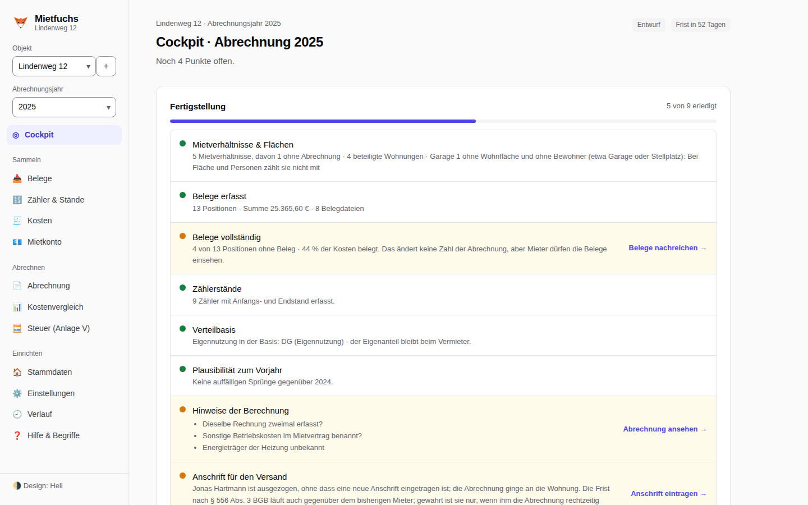
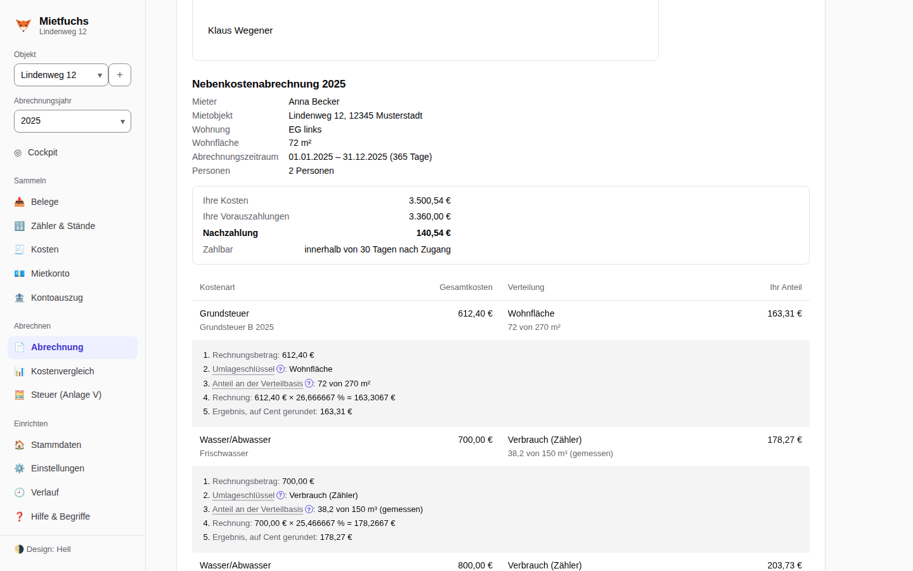
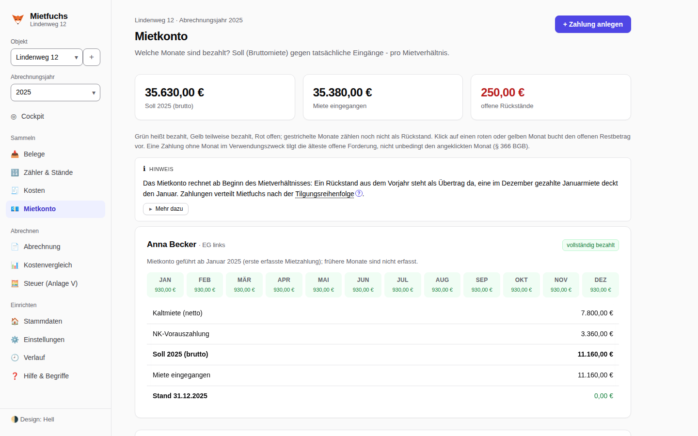
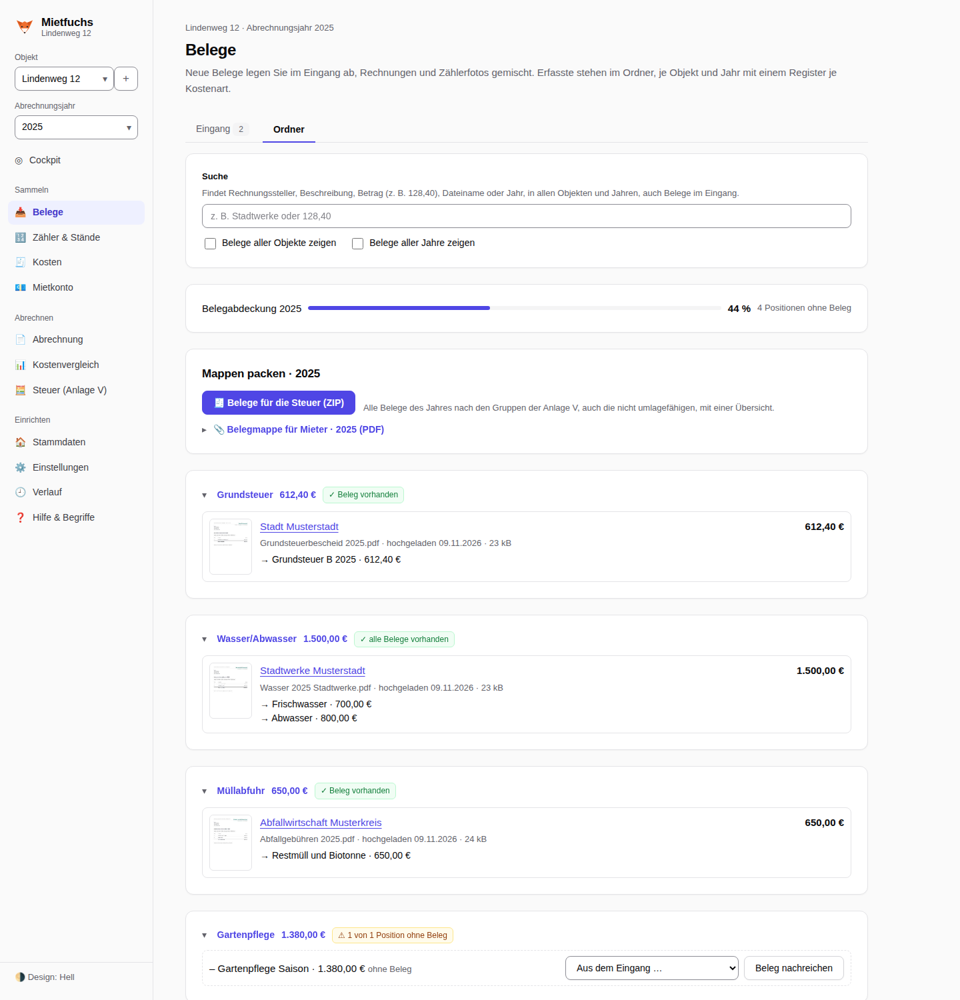
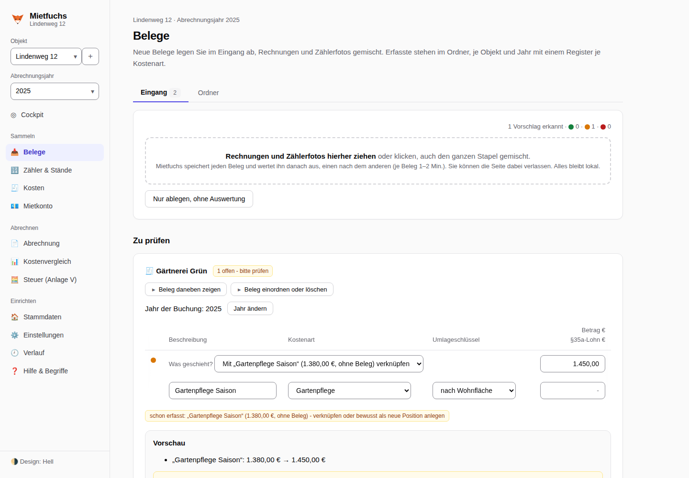
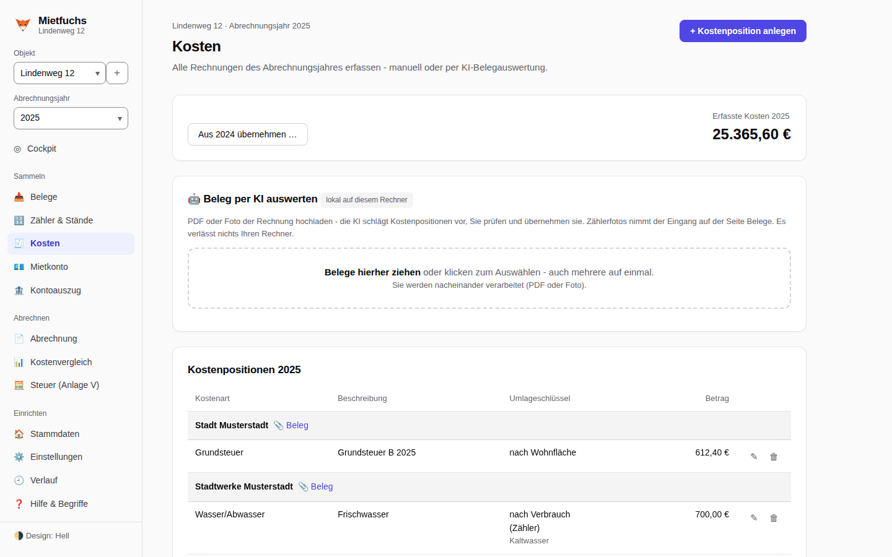
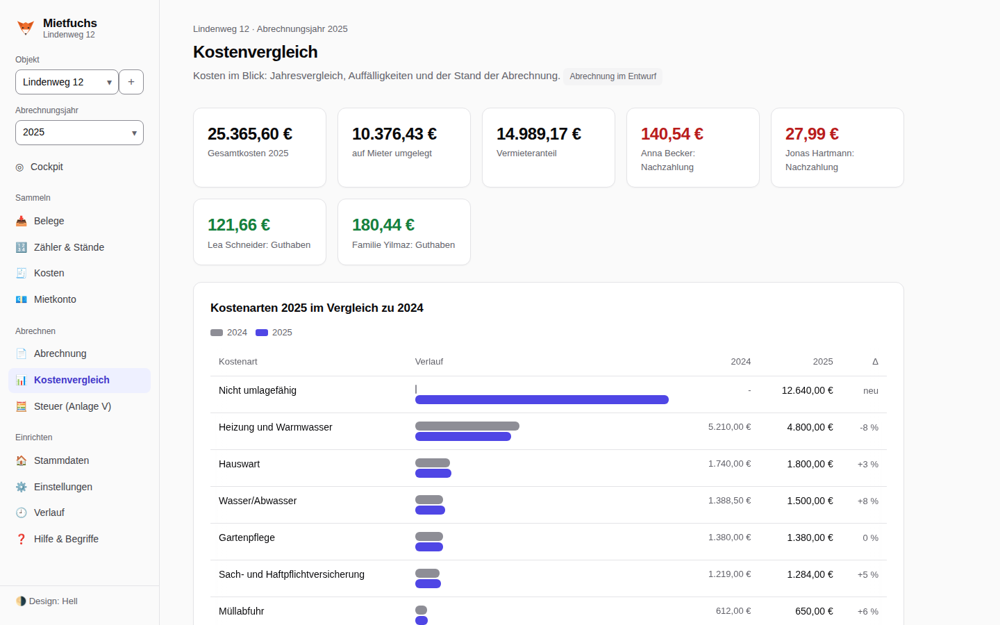
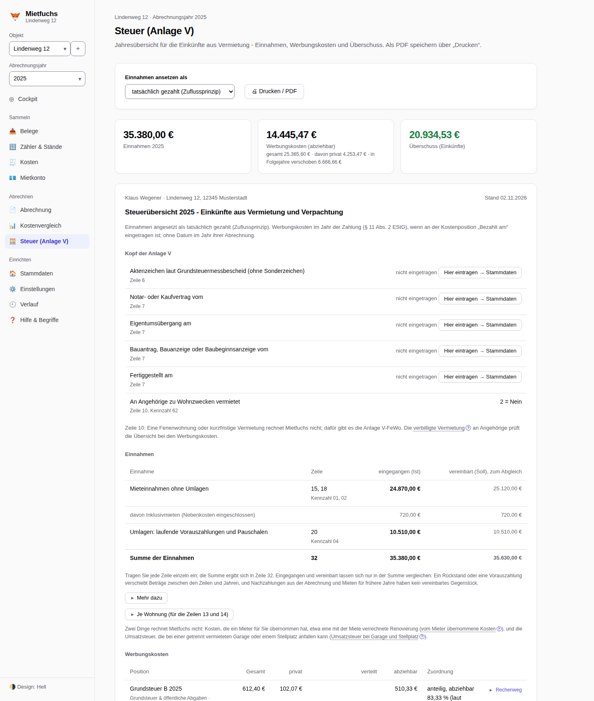
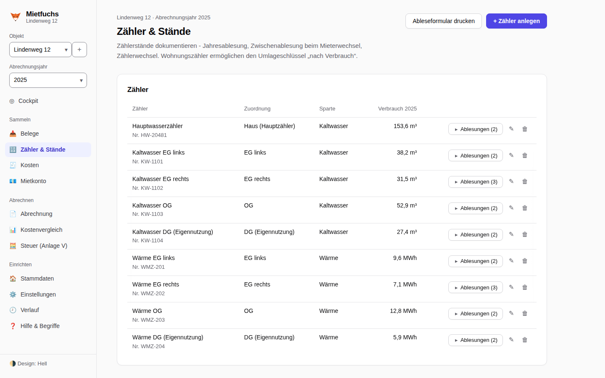

# Funktionsweise

Was Mietfuchs in welchem Bereich tut, Schritt für Schritt von den Stammdaten bis zur Steuer. Die
Kurzfassung steht im [README](../README.md#funktionen).

- [Die Bereiche](#die-bereiche)
- [Umlageschlüssel](#umlageschlüssel)
- [Ansichten](#ansichten)

## Die Bereiche

1. **Stammdaten**: Objekte (ab dem zweiten erscheint ein Umschalter), je Objekt alle
   Wohnungen (auch die selbstgenutzte; sie zählt in die Verteilbasis und ihr Anteil bleibt beim
   Vermieter) und die Mietverhältnisse. Eine Garage oder ein Stellplatz bekommt 0 m² und wird an
   0 Personen vermietet. Personenzahl, Vorauszahlung, Kaltmiete und Pauschale werden als
   **Staffel** geführt („ab X gilt Y“): Geburt, Auszug einzelner Personen oder
   Vorauszahlungs-Erhöhungen brauchen kein neues Mietverhältnis. Je Mietverhältnis lässt sich das
   **Nebenkostenmodell** wählen: Abrechnung, Pauschale oder Inklusivmiete, getrennt für kalte
   Betriebskosten und Heizung. Neben dem Vertragsdatum steht die **Fälligkeit der Miete**: „Wie
   im Gesetz“ (Voreinstellung), „Zu Beginn, spätestens am 3. Werktag“, „An einem festen Tag des
   Monats“ oder „Nach Ablauf des Monats“, dazu „Erste Miete schon bei Mietbeginn fällig“; danach
   rechnet das Mietkonto den Rückstand, mit den Feiertagen des Bundeslands am Objekt. Am Objekt
   steht auch das Baujahr der Kabel- oder Antennenanlage, denn davon hängt ab, ob ihre Kosten nach
   2024 noch umlagefähig sind, und der
   **Abrechnungszeitraum** (Kalenderjahr oder etwa Mai bis April). Unter **Heizung** gibst du an,
   womit geheizt wird, wer den Vertrag hat und wer abrechnet: ein Messdienst, du selbst oder
   niemand, weil jede Wohnung ihre eigene Heizung hat. Daraus richtet Mietfuchs die Seite
   **Heizkosten** ein.
2. **Kosten**: Rechnungen pro Abrechnungsjahr erfassen, manuell oder per
   KI-Belegauswertung. Eine Rechnung kann in mehrere Positionen mit unterschiedlichen
   Umlageschlüsseln zerlegt werden (z. B. Wasserrechnung: Grundgebühr + Verbrauch).
   Optional pro Position: **Lohnanteil nach §35a EStG** (wird dem Mieter bescheinigt). Eine
   Gutschrift wird mit Minus eingetragen. Die Zuführung zur Erhaltungsrücklage einer
   Eigentümergemeinschaft hat eine eigene Kostenart, weil sie steuerlich erst bei Verwendung zählt.
   „Aus dem Vorjahr übernehmen“ legt die Positionen des Vorjahres mit Kostenart, Beschreibung,
   Rechnungssteller und Umlageschlüssel neu an; du trägst je Zeile nur den neuen Betrag ein.
   Eine neue Position bekommt den Schlüssel, den dieselbe Kostenart im Vorjahr hatte, und weicht
   sie davon ab, weisen Formular und Abrechnung darauf hin. Eine Reparatur („Nicht umlagefähig“)
   lässt sich für die Steuer einer Einheit zuordnen.
3. **Belege**: eine Seite mit zwei Ansichten. Im **Eingang** legst du neue Belege ab, auch den
   ganzen Stapel mit Rechnungen und Zählerfotos gemischt. Mit KI wertet Mietfuchs jeden aus (die
   Auswertung läuft weiter, wenn du die Seite wechselst), ohne KI oder mit „Nur ablegen“ speichert er
   sie nur. **E-Rechnungen** (XRechnung als XML-Datei, ZUGFeRD oder Factur-X im PDF) liest Mietfuchs
   auch ohne KI, Betrag, Datum und Positionen kommen direkt aus der Rechnung; eine XML-Datei zeigt er
   geöffnet lesbar an und druckt sie in Belegkopien und Belegmappe mit. Einen Kontoauszug der Bank weist der
   Eingang ab und führt zur Seite Kontoauszug. Darunter steht, was zu prüfen ist, und unter „Ohne Position“ jeder gespeicherte Beleg,
   den du einer Position zuordnest oder per KI auswerten lässt. Der **Ordner** zeigt alle Belege je
   Objekt und Jahr, mit einem Register je Kostenart, Vorschaubild, Betrag und den Positionen, an
   denen ein Beleg hängt; seine Suche durchsucht alle Objekte und Jahre. Die **Belegabdeckung**
   zeigt, welcher Anteil der Kosten belegt ist, und an jeder Position ohne Beleg lässt sich einer
   nachreichen. Denselben Beleg erkennt Mietfuchs am Inhalt, auch unter anderem Namen. Zum
   Jahresende packt der Ordner die **Belegmappe für
   Mieter** (eine PDF mit Deckblatt „Position → Beleg, Seite“ für die Belegeinsicht nach § 556
   Abs. 4 BGB; Belege mit Daten anderer Mieter nur auf ausdrückliche Wahl) und die **Belege für die
   Steuer** (ein ZIP nach den Gruppen der Anlage V, mit einer Übersicht als CSV).
4. **Zähler**: Zähler (Haupt- und Wohnungszähler, auch Wärme- und Warmwasserzähler und
   Heizkostenverteiler) mit Ablesungen: Jahresablesung, Zwischenablesung beim Mieterwechsel
   (exakte Aufteilung), Zählerwechsel (Endstand alt + Startstand neu) mit Plausibilitätswarnung
   bei negativem Verbrauch. Mietfuchs warnt vor abgelaufener Eichfrist und nennt bei Geräten, die
   aus der Ferne ablesbar sein müssen, die Kürzung nach der Heizkostenverordnung. Ein Zähler ohne
   Wohnung misst das ganze Haus (Hauptzähler) oder einen Teil davon, etwa den Allgemeinstrom oder den
   Garten. Einen Stand, den du nicht ablesen konntest, kennzeichnest du als „geschätzt“ mit Begründung;
   gerechnet wird mit ihm wie mit einem abgelesenen, und die Abrechnung nennt die Schätzung beim Mieter.
5. **Heizkosten** (sobald eine Heizanlage angelegt ist): Rechnungen des Versorgers als Lieferungen,
   bei Öl, Flüssiggas, Pellets, Holz und Kohle mit Vorrat; die eigene Heizkostenabrechnung nach
   §§ 7 bis 9 HeizkostenV (Grund- und Verbrauchskosten, Warmwasseranteil gemessen oder nach
   Formel, Mieterwechsel nach Gradtagen, Schätzung nach § 9a) oder die Übernahme der fertigen
   Abrechnung eines Messdienstes, auf Wunsch per KI ausgelesen; die **CO₂-Kosten** nach dem
   Stufenmodell des CO2KostAufG, entweder laut Messdienst oder selbst aus den Lieferungen
   berechnet, samt Ausdruck der Angaben für den Messdienst und Erstattung an Mieter, die selbst
   heizen. Der Betriebsstrom der Heizung lässt sich aus dem Allgemeinstrom herausrechnen.
6. **Abrechnung**: Pro Mieter die fertige Abrechnung mit Kostenaufstellung, Umlageschlüssel,
   Vorauszahlungen, Saldo, Zahlungsaufforderung (Vermieter, IBAN und Frist aus den Einstellungen
   oder abweichend am Objekt),
   §35a-Bescheinigung und Vorschlag zur Vorauszahlungsanpassung (§560 BGB). Bei einer Nachzahlung
   auf Wunsch ein QR-Code zum Bezahlen (EPC-QR-Code für die Banking-App, Verwendungszweck in der
   Vorlage des Anschreibens einstellbar). Dazu eine
   Erinnerung an die 12-Monats-Abrechnungsfrist (§556 BGB). Über „Drucken / PDF" speichern.
   Vor dem Versand wird die Abrechnung **abgeschlossen** und damit eingefroren; ändert sich danach
   etwas, zeigt Mietfuchs die Abweichung je Mieter, und frühere Abschlüsse bleiben im Verlauf. Ist sie
   an die Mieter gegangen, hältst du das mit „Als versendet markieren“ und dem Datum des Versands fest;
   ein Datum nach heute oder vor dem Ende des Abrechnungszeitraums nimmt Mietfuchs nicht an.
7. **Mietkonto**: Welche Monate sind bezahlt? Die Kaltmiete wird (wie die Vorauszahlung) als
   Staffel geführt; **Soll = Bruttomiete = Kaltmiete + NK-Vorauszahlung**. Erfasste
   Zahlungseingänge füllen die Monate der Reihe nach, ein Monatsraster zeigt *bezahlt /
   teilweise / offen*, dazu Brutto/Netto-Aufschlüsselung und fällige Rückstände je Mieter. Ein Monat zählt als
   Rückstand erst ab dem Tag nach dem spätesten erwarteten Eingang der Miete: Fälligkeitstag nach der Regel am
   Mietverhältnis (ohne Angabe wie im Gesetz: zu Beginn, spätestens am dritten Werktag; bei Mietverhältnissen, die
   schon am 01.09.2001 bestanden, nach Ablauf des Monats) und den Feiertagen am Ort, dazu vier Bankgeschäftstage für
   Überweisung und Buchung. Jede Karte sagt „fällig am …“, „fällig seit …, Eingang erwartet bis …“ oder rot „offen
   seit …“. Die Feiertage stehen je Land mit Fundstelle im Rechtsregister; die Gesetze von Bremen und Hamburg sind
   nicht amtlich abrufbar, ihre Listen sind deshalb mit einer amtlichen Übersicht und zwei unabhängigen Feiertagslisten
   abgeglichen. Zeigt das Mietkonto einen
   Rückstand, weist die Abrechnung darauf hin, denn maßgeblich ist, was tatsächlich gezahlt wurde.
   Gehen die Mieten pünktlich und in voller Höhe ein, erfasst „Monate als bezahlt erfassen …“ alle offenen, schon fälligen Monate bis
   zu einem gewählten Monat in einem Schritt, auch rückwirkend: je Monat eine Zahlung über den offenen Rest, für diesen
   Monat und am Fälligkeitstag, nach einer Vorschau. Ein Klick auf einen offenen Monat belegt die einzelne Zahlung
   ebenso vor.
   Beginnt oder endet ein Mietverhältnis im Lauf eines Monats, setzen Mietkonto und Abrechnung
   Miete und Vorauszahlung dieses Monats nach Kalendertagen an (Einzug am 15.03. bei 150 €
   Vorauszahlung: 17 von 31 Tagen, 82,26 €); das ist eine Auslegung, ein Hinweis nennt den Betrag,
   und weicht das Gezahlte ab, trägst du es in der Abrechnung mit „✎ anpassen“ ein.
8. **Steuer (Anlage V)**: Jahresübersicht der Einkünfte aus Vermietung je Objekt: Einnahmen
   nach dem Zuflussprinzip (das vereinbarte Soll lässt sich zum Abgleich einblenden),
   Werbungskosten nach Anlage-V-Gruppen sowie der Überschuss. Wohnst du selbst im Haus, ist die
   Hauptzahl die abziehbaren Werbungskosten, und jede Position steht mit Gesamtbetrag, privatem
   und abziehbarem Teil da: Was einer Einheit direkt zugeordnet ist, gehört ganz zu ihr, Kosten
   des ganzen Gebäudes werden nach Wohn- und Nutzfläche aufgeteilt, bei umlagefähigen Kosten
   gilt der Eigenanteil aus der Nebenkostenabrechnung. Der Rechenweg je Position lässt sich
   aufklappen, und der Ausdruck taugt als gesonderte Aufstellung für das Finanzamt. Hinweise
   nennen, was nicht gerechnet wird (etwa AfA und Schuldzinsen). Bei Inklusivmiete und Pauschale
   gibt es Hinweise zu den Zeilen 24 und 20. Druckbar als PDF. Erweiterte Stammdaten (Kontakt,
   Kaution, Vertragsdatum, Zimmer/Etage) lassen sich optional je Mieter und Wohnung hinterlegen.
   Die Kaution lässt sich am Mietverhältnis führen („Kaution führen“): Eingänge auch in Raten, Zinsen,
   Verrechnungen und Rückzahlungen ergeben den Stand; jede Buchung lässt sich dort ändern. Eine Verrechnung mit Mietrückstand oder Nachzahlung
   legt eine Zahlung im Mietkonto an; Eingang, Zinsen und Rückzahlung stehen weder im Mietkonto noch in der
   Steuerübersicht. Eine als Miete erfasste Kaution buchst du auf der Seite Steuer mit „Als Kaution umbuchen“ um.
   Nach dem Auszug gibt es eine druckbare Aufstellung mit Einbehalt und dem, was auszuzahlen bleibt, und das
   Cockpit erinnert, solange noch Geld bei dir liegt.
9. **Kontoauszug**: Den Auszug deiner Bank als Datei einlesen (camt.052, camt.053, camt.054 oder MT940,
   auch mehrere in einem ZIP). Eine Vorschau zeigt, was gespeichert wird, und fragt nach, wo Mietfuchs es
   nicht weiß: ein Konto, das noch nie eingelesen wurde, und ein Eingang von einer unbekannten IBAN
   (Mieteingang, Kaution oder privat). Passen Name und Betrag zu genau einem Mietverhältnis, ist die
   Antwort vorbelegt; bestätigt wird sie erst mit „Einlesen“. „Alle übrigen als privat“ beantwortet den Rest in
   einem Klick, und ein reines Vermieterkonto legst du gleich mit „Ja, ein Konto nur für die Vermietung“ an; dann
   gibt es keine Rückfragen zu Eingängen, und „Alle Ausgänge ohne Vorschlag beiseitelegen“ räumt nach dem Buchen die
   übrigen Ausgänge weg. Mit „Dieses Konto als Zahler merken“ fragt
   Mietfuchs bei diesem Konto künftig nicht mehr; die Karte „Gemerkte Zahler“ zeigt alle gemerkten Konten
   und nimmt eines mit „Entfernen …“ wieder heraus. Jedes Konto gilt als **Mischkonto**, bis du es als Konto nur für die
   Vermietung bestätigst. Auf einem Mischkonto speichert Mietfuchs nur Umsätze mit deinen Mietern und
   gemerkten Zahlern und Eingänge, die du als Mieteingang oder Kaution einordnest; alles andere nur als
   Summe des Tages. Zweimal eingelesene Tage ändern nichts. Zu jedem offenen Umsatz
   schlägt die Seite Mietverhältnis und Art vor (über die IBAN des Mieters oder eines gemerkten Zahlers), mit Ampel und
   Grund; „Buchen“ legt die Zahlung am Buchungstag im Mietkonto an, eine Kaution als Kautionsbuchung, und
   eine schon von Hand erfasste Zahlung wird nur verknüpft. Ein Umsatz lässt sich auf mehrere Mietverhältnisse
   aufteilen, beiseitelegen oder wieder lösen. Je Konto steht, ob es lückenlos eingelesen ist; über die
   Einnahmen sagt das nichts. Das Cockpit nennt Umsätze, die noch nicht zugeordnet sind. Kontoauszüge
   gehen nie an eine KI: Der Eingang der Belege weist sie ab.

Wie du deine Lage anlegst, steht in Mietfuchs unter **Hilfe & Begriffe**: Anleitungen für das Haus
mit Einliegerwohnung, das Mehrfamilienhaus, die vermietete Eigentumswohnung mit
Hausgeldabrechnung, mehrere Objekte, Garage oder Stellplatz, Pauschale oder Inklusivmiete, die
fertige Abrechnung eines Messdienstes, CO₂-Kosten aufteilen, Heizkosten selbst abrechnen,
Brennstoff mit Tank oder Lager, Kesseltausch und mehrere Heizungen, den Abrechnungszeitraum Mai
bis April, den Mieterwechsel mit Leerstand, die Kaution vom Eingang bis zum Auszug, den Kontoauszug
mit dem Zuordnen der Mieteingänge, die Anmeldung mit Passwort im Netz und das
Programmfenster, das sich mit einem Mietfuchs im Heimnetz verbindet. Jede nennt, ob sie auf
dich zutrifft, die Schritte mit einem Knopf zur passenden Seite, ein nachgerechnetes Beispiel, die
Rechtslage und was Mietfuchs noch nicht kann. Dazu kommt ein Lexikon der Fachbegriffe.

## Umlageschlüssel

- **Wohnfläche** (gesetzlicher Standard nach §556a BGB)
- **Personenzahl** (personentagesgenau, inkl. Personen-Staffel)
- **Wohneinheiten**
- **Verbrauch (Zähler):** Anteil = Verbrauch der Wohnung ÷ Summe aller Wohnungszähler;
  nur wählbar, wenn Wohnungszähler existieren. Fehlt einer Wohnung der Zähler (etwa der
  selbstgenutzten neben einer Einliegerwohnung mit Zwischenzähler), wird der Hauptzähler zur
  Basis; den Rest einer vermieteten Wohnung ohne Zähler trägt dann der Vermieter, mit Warnung.
  Eine Einheit ohne Anschluss (etwa die Garage ohne Wasser) gilt nicht als Wohnung ohne Zähler.
  Den **Allgemeinverbrauch**, also was der Hauptzähler oder ein anderer Bezugszähler mehr misst als
  die Zähler dahinter, kannst du an der Kostenposition selbst verteilen: im Verhältnis der Zähler
  oder nach Fläche, Personen oder Einheiten, auch nur auf bestimmte Wohnungen. Zwischenzähler ohne
  Wohnung (etwa für den Garten) gehen vorher ab und an ein eigenes Ziel. Liegt der Rest bei ganz
  gemessenen Wohnungen über 20 % des Bezugsverbrauchs, warnt Mietfuchs; gemessene und ungemessene
  Wohnungen in einer Gruppe verteilt es nicht. Ohne Wahl bleibt alles wie bisher.
  Verteilst du Wasser nach Personen oder Fläche, obwohl jede bewohnte Wohnung einen Kaltwasserzähler
  hat, weist Mietfuchs auf § 556a Abs. 1 Satz 2 BGB hin; eine abweichende Vereinbarung im Mietvertrag
  geht vor.
  Bei einer Wohnung mit Zimmern (siehe unten) geht der Zähler der Wohnung zuerst auf die Wohnung und dann nach Fläche
  oder Personentagen auf die Zimmer.
- **Direktzuordnung** an eine Wohnung
- **Vereinbarte Anteile** in Prozent je Wohnung
- **Laut Gemeinschaftsabrechnung:** bei der Eigentumswohnung den eigenen Anteil aus der
  Hausgeldabrechnung übernehmen, nach Miteigentumsanteilen, Fläche oder je Einheit
- **Einzelbeträge** je Mietverhältnis, etwa aus der fertigen Abrechnung eines Messdienstes

## Zimmer einer Wohnung (WG)

Vermietest du die Zimmer einer Wohnung einzeln, jeweils mit eigenem Vertrag, legst du die Wohnung mit ihrer
Gesamtfläche an und jedes Zimmer als eigene Einheit; dort wählst du „Liegt als Zimmer in der Wohnung“. Die
Wohnung selbst hat kein Mietverhältnis und keine Nutzung, beides gehört an die Zimmer. Wer ein Haus im Ganzen
vermietet, merkt davon nichts.

- **Fläche:** Jedes Zimmer zählt mit dem Anteil an der Wohnfläche, den es an den Zimmerflächen hat. Die ganze Wohnung mit
  Küche, Bad und Flur zählt so genau einmal. Fehlt die Fläche der Wohnung, rechnet Mietfuchs mit den Zimmerflächen, wie sie
  stehen, und warnt.
- **Einheiten:** Beim Schlüssel „Wohneinheiten“ zählt die Wohnung einmal, nicht je Zimmer.
- **Zähler der Wohnung:** Der Zähler der Wohnung (Kaltwasser, Strom, Sonstiges) erfasst den Verbrauch der Wohnung, nicht
  den des Zimmers. Mietfuchs rechnet ihn deshalb erst der Wohnung zu und teilt ihn dann auf die Zimmer, nach Fläche oder
  nach Personentagen (Auswahl „Zähler der Wohnung auf die Zimmer verteilen nach“ an der Kostenposition). Für Zimmer ohne
  eigenen Zähler gibt es keinen erfassten Verbrauch, der vorginge.
- **Heizung:** Jeder Zimmermieter ist Nutzer im Sinne der Heizkostenverordnung (§ 1 HeizkostenV), die Verordnung geht
  abweichenden Vereinbarungen vor (§ 2). Mietfuchs legt § 4 Abs. 3 HeizkostenV so aus, dass die Erfassung in den Zimmern
  genügt: Wärme-, Warmwasser- und Heizkostenverteilerzähler gehören an die Zimmer. Wird die Heizung der WG nach Fläche
  oder Personen geteilt, gelten die bekannten Hinweise zum Kürzungsrecht nach § 12 HeizkostenV. Ob eine Gastherme, die nur
  die WG beheizt, unter die Verordnung fällt, ist ungeklärt.
- **Strom und Internet der WG** sind keine Betriebskosten (§ 556 Abs. 1 BGB, § 1 BetrKV), und eine Vereinbarung macht sie
  nicht dazu (§ 556 Abs. 4 BGB). Zulässig ist eine gesonderte Zahlungsabrede neben den Betriebskosten, etwa eine Pauschale
  oder eine Abrechnung nach Zähler. Mietfuchs rechnet solche Positionen auf Wunsch mit ab und weist darauf hin.
- **Umbau zur WG:** Eine bisher im Ganzen vermietete Wohnung behältst du für die alten Jahre, nimmst sie ab dem Umbau per
  Nutzungswechsel heraus und legst eine neue Wohnung mit Zimmern an.

Je Position lässt sich die Verteilbasis auf bestimmte Wohnungen eingrenzen (z. B. Aufzug nur für
die oberen Etagen). Korrekturen der tatsächlich gezahlten Vorauszahlungen (z. B. ausgefallene
Zahlung) direkt in der Abrechnung über „✎ anpassen".

Zeiträume ohne Mieter (Leerstand), der Anteil selbstgenutzter Wohnungen und von Mietverhältnissen
mit Pauschale oder Inklusivmiete sowie Positionen „Nicht umlagefähig" trägt der Vermieter. Alle
Beträge werden intern in Cent gerechnet und centgenau verteilt (Hare-Verfahren).

Eine Kostenposition gehört zu dem Abrechnungszeitraum, dem sie beim Erfassen zugeordnet wird;
eine Rechnung über zwei Zeiträume teilt Mietfuchs nach Tagen auf (Heizkosten ausgenommen). Für
Heizung und Warmwasser gibt es eigene Wege (siehe **Heizkosten** oben): die eigene
Heizkostenabrechnung nach der Heizkostenverordnung, die Übernahme einer fertigen
Messdienstabrechnung als Einzelbeträge und die Aufteilung der CO₂-Kosten. Werden Heizkosten ohne
Verbrauchsanteil verteilt, nennt ein Hinweis das Kürzungsrecht des Mieters nach § 12
HeizkostenV. Was Mietfuchs bei der Heizung nicht rechnet, sagt es an Ort und Stelle, etwa die
Vorerfassung nach Nutzergruppen oder eine getrennte Heizkostenabrechnung nach einem
Kesseltausch.

## Ansichten

> Alle Abbildungen zeigen frei erfundene Beispieldaten (ein Mehrfamilienhaus „Lindenweg 12,
> 12345 Musterstadt“ mit selbstgenutzter Dachwohnung und Garage, dazu eine vermietete
> Eigentumswohnung), ohne echte Personen, Adressen oder Kontodaten. Die Bilder entstehen mit
> `npm run screenshots` neu.

| Abrechnung je Mieter, mit Rechenweg | Mietkonto (Soll/Ist je Monat) |
| --- | --- |
|  |  |

| Belege: der Ordner | Auswertung prüfen im Eingang: verknüpfen statt doppelt erfassen |
| --- | --- |
|  |  |

| Kosten | Kostenvergleich |
| --- | --- |
|  |  |

| Steuer-Übersicht (Anlage V) mit Eigennutzung | Zähler & Stände |
| --- | --- |
|  |  |

Weitere Ansichten: [Stammdaten](screenshots/stammdaten.png), [Hilfe mit Anleitungen je Vermietungsart](screenshots/hilfe.png).
